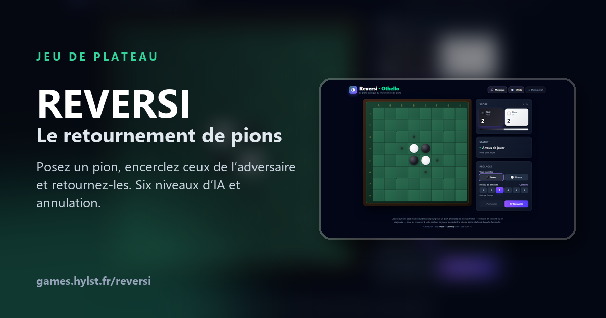

# Reversi

**Le retournement de pions.**

Reversi, le grand classique du retournement : posez un pion, encerclez ceux de l'adversaire et retournez-les. Six niveaux d'IA, annulation et partie nouvelle.

Joue ici : [games.hylst.fr/reversi/](https://games.hylst.fr/reversi/)



## Comment on joue

- Plateau 8 x 8 avec coups valides, retournements animés et coordonnées.
- Six niveaux d'IA, choix de la couleur, annulation et nouvelle partie.
- Score en direct, statut, passe automatique, musique et effets, plein écran.

## Technique

- React 19, TypeScript, Vite 7 et Tailwind CSS 4.
- Build en un seul fichier `index.html`, sans dépendance à l'exécution.
- Aucune requête réseau pendant la partie, aucun compte, aucun cookie.

```bash
npm ci
npm run build
```

Le build sort dans `dist/`. Le fichier `index.html` suffit pour jouer ; `og-image.png` et `icon.webp` accompagnent la publication.

## Structure

```
src/App.tsx              mise en page
src/components/Board.tsx plateau et cases
src/game/GameContext.tsx état, tours et IA
src/game/reversi.ts      règles et coups
src/game/audio.ts        musique et effets
```

## Licence

AGPL-3.0-or-later. Voir `LICENSE`.

Jeu créé par Geoffroy (Hylst) avec l'aide d'une IA.
